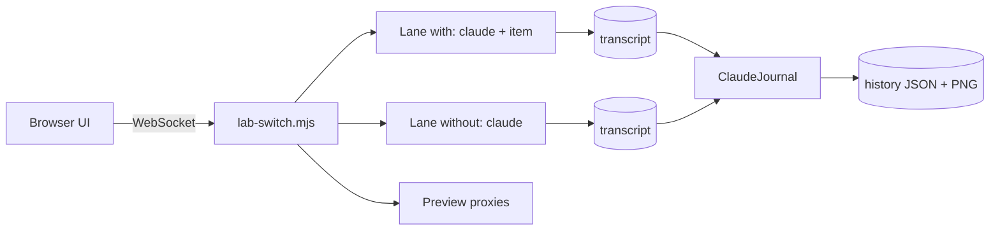

# Design

## Overview

One Node.js process serves the UI, owns two PTY lanes and records rounds. The browser is a thin client over a single WebSocket.

## Components

- **Configuration (`lib/config.mjs`)**: parses flags, resolves the item kind, prepares each profile and project copy, and builds the host git environment.
- **Auth (`lib/auth.mjs`)**: reads the current OAuth token from the credentials file or Keychain, or falls back to `CLAUDE_CODE_OAUTH_TOKEN` and `ANTHROPIC_API_KEY`. Re-read on every New pair.
- **Lanes (`lab-switch.mjs`)**: each lane holds a `node-pty` process and a headless xterm mirror. Status moves through starting, ready, busy, stopping and stopped or error.
- **Telemetry (`lib/telemetry.mjs`)**: `ClaudeJournal` tails the session transcript by byte offset, groups entries into turns and `turnSummary` produces the metrics.
- **History (`lib/history.mjs`)**: validates UUID ids, writes atomically with private modes and lists the latest 100 rounds.
- **Snapshot (`lib/snapshot.mjs`)**: finds a Chromium-family browser and captures a page to PNG.
- **Remote (`lib/remote.mjs`)**: loads or creates the token, gates HTTP and WebSocket requests by cookie and runs one preview proxy per lane.

## WebSocket messages

| Client to server | Purpose |
|---|---|
| `input` | Keystrokes for one lane, up to 16,000 characters |
| `resize` | Terminal size shared by both lanes |
| `send` | Shared prompt for both lanes |
| `reset` | New pair |
| `stop` | Stop both lanes |
| `history-list`, `history-open` | Read rounds |

## Error handling

- A slow socket over 1 MiB of buffered output is closed with code 1013.
- Missing browser means a round without screenshots, not a failed round.
- Partial usage data becomes `null` so the UI shows unknown instead of a wrong total.

## Testing

`test/lab.test.mjs` starts the server in demo mode against `test/pty-fixture.mjs`, drives it over WebSocket and checks sends, permission bypass, history, preview detection with ANSI colors, screenshots through `test/fake-browser.mjs`, token access, git inheritance, shutdown and origin rejection.
